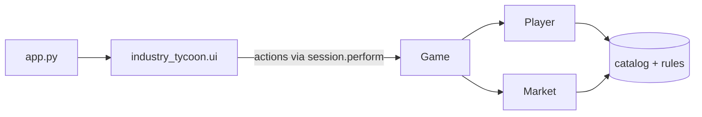

<div align="center">

# 🏭 Industry Tycoon — Companion Web App

**The bookkeeper for _Industry Tycoon_, a 2–4 player strategy board game about cornering
resources, building industry and bankrupting your rivals.**

[](https://github.com/benjamin-codes-labs/IndustryTycoon_WebSystemForGame/actions/workflows/ci.yml)


English · [繁體中文](README.zh-Hant.md)

</div>

---

_Industry Tycoon_ is played on a physical board, but its economy (sales, construction costs,
per-turn upkeep, factory output and a randomized inflation model) involves too much arithmetic
to do by hand. This web app keeps the books so players can focus on the board: pass the device
to whoever's turn it is, press the buttons that match what happened on the table, and the app
does the rest.

> [!NOTE]
> The in-app interface is in Traditional Chinese. The full rulebook is in
> [`docs/RULES.md`](docs/RULES.md).

## Contents

- [Features](#features)
- [Quick start](#quick-start)
- [Using the app](#using-the-app)
- [Project structure](#project-structure)
- [Architecture](#architecture)
- [Development](#development)
- [Deployment](#deployment)

## Features

- **Turn and round tracking.** Ending a turn automatically charges upkeep, delivers processed
  goods, pays out collection plants and skips eliminated players.
- **12 characters.** Each character's economic modifiers (sale bonuses, construction discounts,
  capture bounties) are applied automatically.
- **Industry.** Build collection and processing plants, with a live preview of what an
  investment will yield.
- **Living market.** Prices are re-indexed at the start of every round by an inflation model
  driven by the total wealth in play.
- **Pieces and conflict.** Buy pieces, record synthesized ones, capture enemy pieces, destroy
  plants and buy insurance.
- **Eliminations.** Manual elimination when a King falls, plus automatic elimination after
  three consecutive bankrupt turns.
- **Live leaderboard** ranking every player by net worth.
- **Clear feedback.** Every action reports its result; rejected actions explain why and leave
  the game state untouched.

## Quick start

Requires Python 3.10 or newer.

```bash
git clone https://github.com/benjamin-codes-labs/IndustryTycoon_WebSystemForGame.git
cd IndustryTycoon_WebSystemForGame
python -m venv .venv && source .venv/bin/activate   # Windows: .venv\Scripts\activate
pip install -r requirements.txt
streamlit run app.py
```

The app opens at <http://localhost:8501>. A tablet or laptop is recommended at the table.

## Using the app

### 1. Set up the game

Choose the number of players, then enter each player's name and character in turn order.
Blank names default to `玩家 1`, `玩家 2`, …; duplicate names are rejected. Expand
**角色能力一覽** to compare what each character's modifiers do.

### 2. Play a turn

The header always shows whose turn it is, their money, per-turn upkeep, building count and the
current inflation multiplier. Actions are grouped into tabs:

| Tab | Use it to |
|---|---|
| 📦 原料與收集廠 · Resources | Take raw resources drawn from cards; build collection plants. |
| 🏭 加工廠 · Processing | Build processing plants; invest raw resources to produce goods. |
| 💰 市場 · Market | See current prices; sell one resource or everything at once. |
| ♟️ 棋子與保險 · Pieces | Buy pieces, record synthesized pieces, buy insurance. |
| ⚔️ 對戰與淘汰 · Conflict | Destroy a collection plant, capture a piece, mark eliminations. |

The sidebar shows the current player's holdings and a leaderboard ranked by net worth (money
plus the market value of all resources and pieces). Use it to settle the winner if the game
ends early.

### 3. End the turn

Press **下一位玩家** (_next player_). The app then:

1. Charges the outgoing player their upkeep (money never drops below zero).
2. Delivers the goods they processed this turn.
3. Passes the turn to the next player who has not been eliminated. Passing the last seat
   starts a new round, and every price is re-indexed for inflation.
4. Eliminates the incoming player if they have started three consecutive turns with no money.
5. Credits the incoming player with the output of their collection plants.

## Project structure

```text
.
├── app.py                    # Streamlit entry point
├── industry_tycoon/          # Application package
│   ├── catalog.py            # Balance data: resources, goods, pieces, characters
│   ├── rules.py              # Scalar rules: limits, costs, inflation tuning
│   ├── player.py             # Per-player state
│   ├── market.py             # Live prices, valuation and the inflation model
│   ├── game.py               # Game aggregate: player actions and turn flow
│   ├── errors.py             # GameRuleError
│   ├── formatting.py         # Money formatting
│   └── ui/                   # Streamlit presentation layer
│       ├── session.py        # Session state, toasts and the action adapter
│       ├── setup_view.py     # Pre-game setup screen
│       ├── game_view.py      # Game screen: header and tabs
│       ├── sidebar.py        # Holdings, leaderboard, new-game control
│       ├── components.py     # Shared presentation helpers
│       └── tabs/             # One module per tab
├── tests/                    # Unit tests and headless UI tests
├── docs/RULES.md             # Full game rulebook
└── .github/workflows/ci.yml  # Lint, type-check and test on every push
```

## Architecture



- **The domain layer is plain Python.** `Game`, `Player` and `Market` never import Streamlit,
  so all game logic is unit tested directly.
- **Actions are all-or-nothing.** An action either completes fully or raises `GameRuleError`
  with a player-facing message, leaving state untouched.
- **The UI is a thin adapter.** Widget callbacks go through `session.perform`, which runs the
  action and turns its outcome into a toast notification.
- **There is a single source of truth for balance.** Every price, multiplier and limit lives in
  `catalog.py` or `rules.py`.

## Development

```bash
pip install -r requirements-dev.txt

pytest              # unit tests + headless UI tests (streamlit.testing)
ruff check .        # lint
ruff format .       # format
mypy                # strict type-check
```

CI runs all of the above on Python 3.10 and 3.12.

**Tuning the balance.** Edit the tables in [`industry_tycoon/catalog.py`](industry_tycoon/catalog.py)
or the constants in [`industry_tycoon/rules.py`](industry_tycoon/rules.py), then run `pytest`.
Remember to keep [`docs/RULES.md`](docs/RULES.md) in sync.

## Deployment

The app runs as-is on [Streamlit Community Cloud](https://streamlit.io/cloud). Point it at this
repository with **`app.py`** as the main file; dependencies are read from `requirements.txt`.
