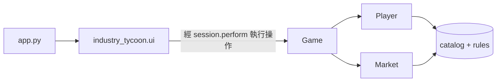

<div align="center">

# 🏭 Industry Tycoon（產業大亨）— 配套網頁系統

**為 2–4 人策略桌遊《Industry Tycoon》而設的記帳系統：搶佔資源、發展工業、讓對手破產。**

[](https://github.com/benjamin-codes-labs/IndustryTycoon_WebSystemForGame/actions/workflows/ci.yml)


[English](README.md) · 繁體中文

</div>

---

《Industry Tycoon》在實體棋盤上進行，但遊戲的經濟系統（售賣、建造成本、每回合支出、工廠產出及隨機的通貨膨脹模型）計算量太大，難以人手處理。本系統負責所有帳目：輪到誰，就把裝置交給誰，按下與棋盤上發生的事相對應的按鈕，其餘交給系統。

> [!NOTE]
> 完整遊戲規則請參閱 [`docs/RULES.zh-Hant.md`](docs/RULES.zh-Hant.md)。

## 目錄

- [功能](#功能)
- [快速開始](#快速開始)
- [使用說明](#使用說明)
- [專案結構](#專案結構)
- [架構](#架構)
- [開發](#開發)
- [部署](#部署)

## 功能

- **回合與輪次管理**：結束回合時自動扣除支出、交付加工產品、發放收集廠產出，並跳過已淘汰的玩家。
- **12 位角色**：自動套用每位角色的經濟修正（出售加成、建造折扣、擊殺獎勵等）。
- **工業發展**：建造收集廠與加工廠，投入資源前可即時預覽產出。
- **動態市場**：每回合開始時，系統會根據場上總財富以通貨膨脹模型重新定價。
- **棋子與對戰**：購買棋子、記錄合成棋子、擊殺敵方棋子、摧毀收集廠、購買保險。
- **淘汰機制**：國王被消滅時手動淘汰；連續三回合破產會自動淘汰。
- **即時排行榜**：按總資產為所有玩家排名。
- **清晰回饋**：每個操作都會顯示結果；被拒絕的操作會說明原因，且不會改變任何遊戲資料。

## 快速開始

需要 Python 3.10 或以上版本。

```bash
git clone https://github.com/benjamin-codes-labs/IndustryTycoon_WebSystemForGame.git
cd IndustryTycoon_WebSystemForGame
python -m venv .venv && source .venv/bin/activate   # Windows：.venv\Scripts\activate
pip install -r requirements.txt
streamlit run app.py
```

系統會在 <http://localhost:8501> 開啟。遊戲時建議使用平板電腦或筆記型電腦。

## 使用說明

### 1. 設定遊戲

選擇玩家人數，然後按行動順序輸入每位玩家的名稱及角色。名稱留空會預設為 `玩家 1`、`玩家 2`……；名稱不能重複。展開 **角色能力一覽** 可比較各角色的自動修正。

### 2. 進行回合

頁首會顯示目前輪到的玩家、金錢、每回合支出、建築數量及目前的通貨膨脹倍率。各項操作分成以下分頁：

| 分頁 | 用途 |
|---|---|
| 📦 原料與收集廠 | 拿取資源卡上的原料；建造收集廠。 |
| 🏭 加工廠 | 建造加工廠；投入原料生產加工品。 |
| 💰 市場 | 查看目前價格；出售單一資源或全部資源。 |
| ♟️ 棋子與保險 | 購買棋子、記錄合成棋子、購買保險。 |
| ⚔️ 對戰與淘汰 | 摧毀收集廠、擊殺棋子、標記淘汰。 |

側邊欄顯示目前玩家的資產，以及按總資產（金錢加上所有資源與棋子的市值）排列的排行榜。若提前結束遊戲，可用排行榜決定勝負。

### 3. 結束回合

按下 **下一位玩家**，系統會依序：

1. 向當前玩家收取每回合支出（金錢不會低於零）。
2. 交付該玩家本回合加工的產品。
3. 把回合交給下一位未被淘汰的玩家；越過最後一個座位即開始新一輪，所有價格按通貨膨脹重新計算。
4. 若下一位玩家已連續三個回合以零金錢開始，將其淘汰。
5. 向下一位玩家發放其收集廠的產出。

## 專案結構

```text
.
├── app.py                    # Streamlit 入口
├── industry_tycoon/          # 應用程式套件
│   ├── catalog.py            # 平衡數據：資源、加工品、棋子、角色
│   ├── rules.py              # 規則常數：上限、費用、通膨參數
│   ├── player.py             # 玩家狀態
│   ├── market.py             # 即時價格、估值與通膨模型
│   ├── game.py               # 遊戲聚合：玩家操作與回合流程
│   ├── errors.py             # GameRuleError
│   ├── formatting.py         # 金額格式
│   └── ui/                   # Streamlit 介面層
│       ├── session.py        # Session 狀態、通知與操作轉接
│       ├── setup_view.py     # 遊戲設定畫面
│       ├── game_view.py      # 遊戲畫面：頁首與分頁
│       ├── sidebar.py        # 資產、排行榜、開始新遊戲
│       ├── components.py     # 共用顯示工具
│       └── tabs/             # 每個分頁一個模組
├── tests/                    # 單元測試與無頭 UI 測試
├── docs/RULES.zh-Hant.md     # 完整遊戲規則
└── .github/workflows/ci.yml  # 每次推送時執行 lint、型別檢查與測試
```

## 架構



- **領域層是純 Python**：`Game`、`Player` 與 `Market` 不依賴 Streamlit，所有遊戲邏輯都可直接進行單元測試。
- **操作要麼全部完成，要麼完全不生效**：違反規則時會拋出附有玩家可讀訊息的 `GameRuleError`，狀態保持不變。
- **介面層只負責轉接**：所有元件回呼都經 `session.perform` 執行操作，並把結果轉為通知。
- **平衡數據只有單一來源**：所有價格、倍率與上限都定義在 `catalog.py` 或 `rules.py`。

## 開發

```bash
pip install -r requirements-dev.txt

pytest              # 單元測試 + 無頭 UI 測試（streamlit.testing）
ruff check .        # lint
ruff format .       # 格式化
mypy                # 嚴格型別檢查
```

CI 會在 Python 3.10 及 3.12 上執行以上所有檢查。

**調整遊戲平衡**：修改 [`industry_tycoon/catalog.py`](industry_tycoon/catalog.py) 中的表格或 [`industry_tycoon/rules.py`](industry_tycoon/rules.py) 中的常數，然後執行 `pytest`。記得同步更新 [`docs/RULES.zh-Hant.md`](docs/RULES.zh-Hant.md)。

## 部署

本系統可直接部署到 [Streamlit Community Cloud](https://streamlit.io/cloud)：選擇此儲存庫，主檔案設為 **`app.py`**，依賴項目會從 `requirements.txt` 讀取。
